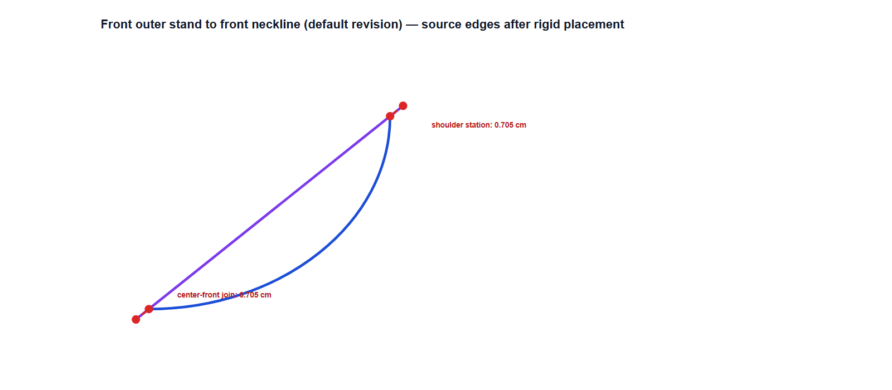
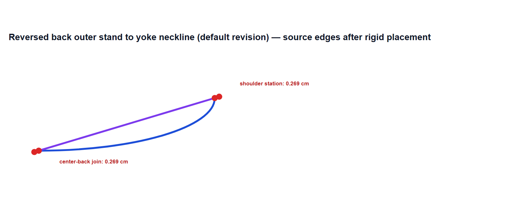

# Slice 342 — Woven stand/neckline source overlay review

## Directly encoded facts

The Woven collar stitch names one straight `outerStand.neckline` edge on side A and the ordered two-edge interface `front.neckline`, `yoke.neckline` on side B. The default stand line runs from its front-end attachment at `(25.7772, 2.5)` to the center-back fold at `(0, 2.5)`. Its length equals the front and yoke neckline curves' total lengths. The front cubic runs CF→shoulder; the yoke cubic runs CB→shoulder. No stitch ease is declared. All exact edges, option values and transforms for the 28 option configurations are in `source-assembly-matrix-s336.json`; `current-crosswalk.json` verifies all 28 option records against S341 with no differences and carries the production-reported per-face residuals.

The projection code reverses the ordered yoke neckline only as required to traverse the source stitch sequence on the back face. S321's approved normalized CB-to-CF station is still valid and source-checked. The S336 images below show a different problem: rigidly placing one straight stand-base edge against two curved body edges cannot make both endpoints coincide. A normalized exterior collar station does not define how those different base-seam strokes should be represented together.

## Front face overlay

Purple is transformed `outerStand.neckline`; blue is source `front.neckline`. Red marks show the two endpoint discrepancies. The default CF gap is 0.705 cm and the station-to-shoulder gap is 0.705 cm. Across all 28 configurations, corresponding gaps are 0.688–0.740 cm.

## Back face overlay

Purple is the back-facing transformed/reversed `outerStand.neckline`; blue is source `yoke.neckline`. Red marks show the CB and shoulder-station gaps. The default gaps are 0.269 cm; across all 28 configurations they are 0.263–0.283 cm.

## Proposed mapping requiring maintainer approval

If approved, depict the base seam once from the source body interface: `front.neckline` cubic CF-to-shoulder on `FRONT_FLAT`; `yoke.neckline` cubic CB-to-shoulder on `BACK_FLAT`, with yoke on the back-facing seam layer. Suppress the duplicate `outerStand.neckline` stroke in these assembled views only. Keep the stand's exterior contour and all source pattern pieces, cut edges, stitch graph and collar exterior station unchanged. Render the single base-seam path in `SEAM` above silhouette and below details/callouts. This view rule represents which geometry supplies the visible sewn interface; it is not sourced as a physical construction rule.

The convention removes the duplicated misaligned stroke from the drawing, not the independent sleeve-cap conflicts. It therefore cannot release a Woven face alone. Keeping the current representation preserves the current full 56-face hold. No part of this proposal has been implemented.
